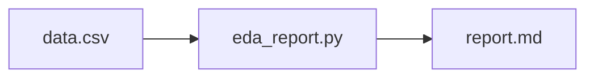

# Architecture — Automatic EDA Assistant

## Inputs

- `sample/data.csv`

## Source files

- `src/eda_report.py`

## Output

- `results/artifacts/report.md`

This representation is intended for source navigation. It does not imply a production deployment or undisclosed components. The editable diagram is available as [`architecture.mmd`](architecture.mmd).
